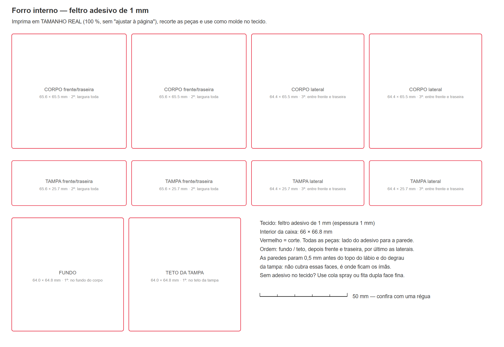
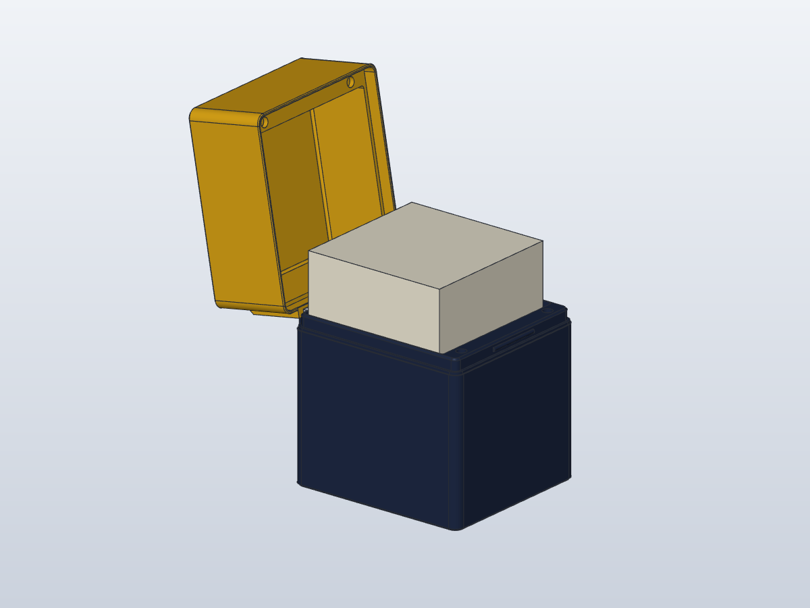
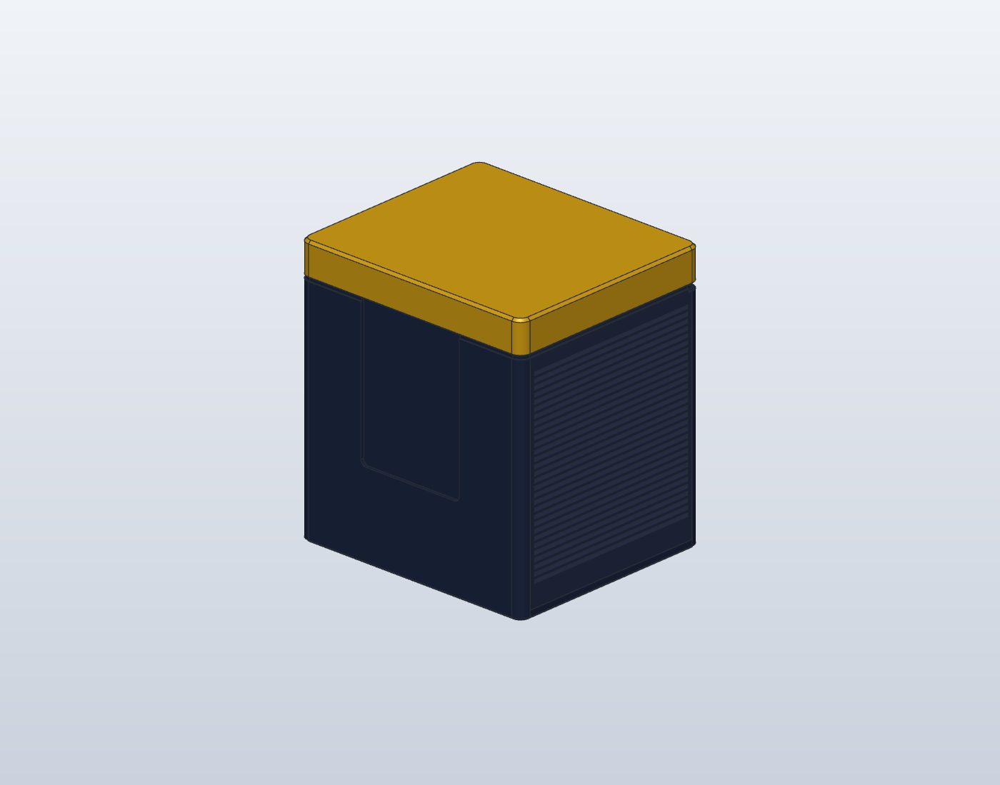
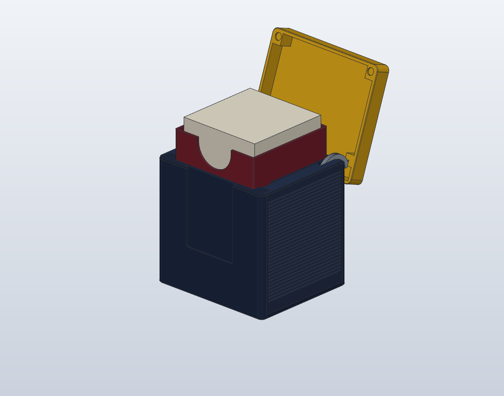
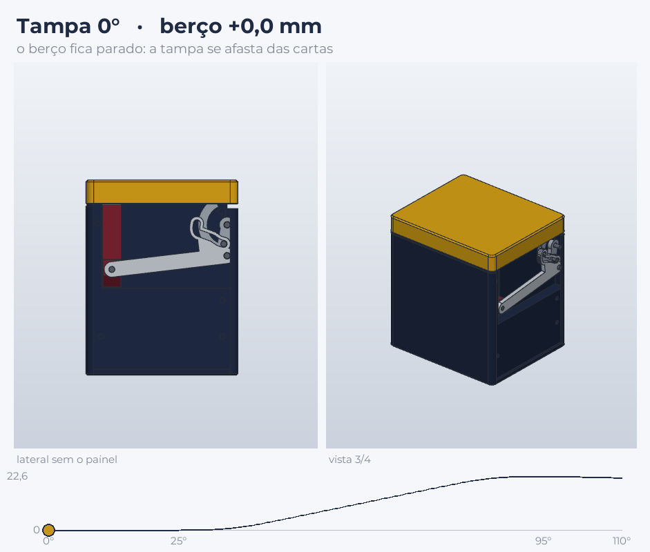
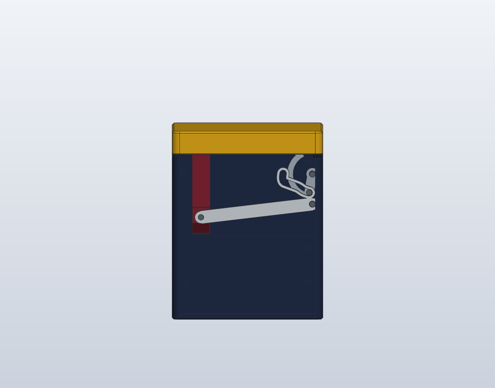
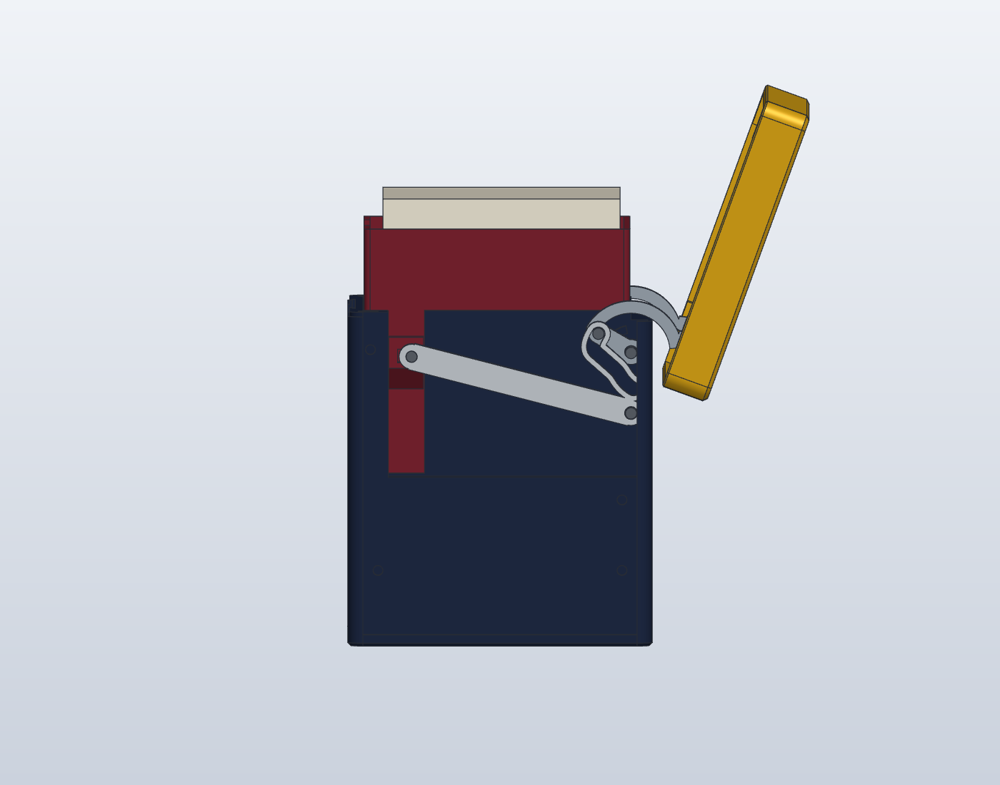
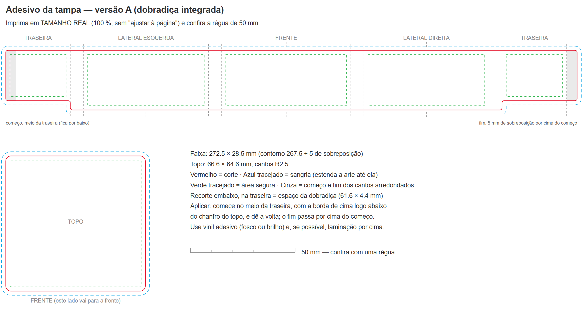

# Deck box YGO — impressão 3D em ABS

Deck box para **90 cartas com sleeve duplo** (tamanho japonês, 62 × 89 mm): main + extra + side deck, com espaço para **forro de tecido** por dentro.
Tem tampa basculante, **fechamento com ímãs** e trava de clique, **porta-arte trocável** na frente e divisória removível, e imprime **sem suporte**.
Modelada em [SolidCraft](https://github.com/bherbruck/solidcraft), 100 % paramétrica.


## Qual versão imprimir

A caixa é a mesma nas duas versões; muda só a dobradiça.

| | **A — dobradiça integrada** | **B — dobradiça colada** |
|---|---|---|
| Visual |  |  |
| Dobradiça | 5 nós impressos na própria caixa | dobradiça de 50 × 38 mm colada num rebaixo-guia: **de metal** (2") ou a **impressa print-in-place** deste repositório |
| Pino | 61,6 mm de filamento 1,75 (ou aço de 2 mm) | já vem na dobradiça |
| Abertura | até ~168° | até 180° |
| Pasta | [`stl/A-dobradica-integrada`](stl/A-dobradica-integrada) | [`stl/B-dobradica-colada`](stl/B-dobradica-colada) |

Cada pasta tem tudo que precisa ser impresso para aquela versão.

A **versão C — elevador** é outra caixa: ao abrir a tampa, um mecanismo escondido nas laterais **ergue as cartas 22 mm** acima da borda. Está na [seção própria](#versão-c--elevador-cinemática) e em [`stl/C-elevador`](stl/C-elevador).

---

## Cartas, folga e forro

O interior é calculado a partir da carta com sleeve, do forro e de uma folga livre. Tudo isso são parâmetros.

| | Medida | Fonte |
|---|---|---|
| Carta Yu-Gi-Oh! | 59 × 86 mm | [Gamegenic](https://www.gamegenic.com/product/japanese-size-prime-sleeves/), [Dragon Shield](https://www.dragonshield.com/collections/japanese-size-sleeves) |
| Sleeve interno (perfect fit) | 59 × 86 mm | [Dragon Shield Perfect Fit](https://www.miniaturemarket.com/at-13051.html) |
| Sleeve externo (tamanho japonês) | 62 × 89 mm | [Gamegenic](https://www.jbhifi.com.au/products/gamegenic-prime-japanese-sized-sleeves-size-code-pink-sleeve-colour-red-62mmx89mm-60-sleeves-per-pack), [Ultimate Guard](https://ultimateguard.com/en/Cortex/Cortex-Sleeves/UGD011179) |
| Espessura por carta com sleeve duplo | ~0,65 mm (varia com a marca) | caixas comerciais: 70 cartas com sleeve duplo em ~46 mm ([guia](https://geekydomain.com/blogs/guides/best-deck-boxes-every-game)) |

**Valores de projeto** (com margem para costura do sleeve e tolerância):

| Parâmetro | Padrão | O que é |
|---|---|---|
| `card_w` × `card_h` | 62,5 × 91 | carta com sleeve, na prática |
| `card_t` | 0,68 | **calibre:** meça 40 cartas com sleeve e divida por 40 |
| `n_cards` | 90 | capacidade |
| `liner_t` | 1,0 | **forro** em todas as faces internas (feltro adesivo de 1 mm; use 0,5 para veludo adesivo e 0 sem forro) |
| `play_x` / `play_y` / `play_z` | 1,5 / 2 / 1,5 | folga livre que sobra depois do forro |

Resultado: interior de **66 × 66,8 × 94,5 mm**.

### Forro interno

**Tecido recomendado:**
- **Veludo / flocado autoadesivo** (~0,5 mm, o de forrar caixa de joia): visual premium e o sleeve desliza bem.
- **Feltro adesivo de 1 mm:** mais barato e esconde melhor as linhas de camada.

Os dois já vêm com cola. Se o tecido não tiver adesivo, use **cola spray** (tipo 3M Super 77) ou fita dupla face fina. **Cola branca não segura bem no ABS** e mancha tecido fino.

**Gabarito de corte** (escala 1:1, A4): `forro/forro_feltro_1mm.svg` e `forro/forro_veludo_0-5mm.svg`.
- São 10 peças: fundo, frente, traseira e laterais do corpo, teto e paredes da tampa.
- Cada peça tem nome, medida e ordem de colagem.



O de veludo tem as mesmas peças, com as medidas para 0,5 mm: [prévia](images/forro_veludo_0-5mm.png).

**Como forrar:**
1. Passe uma lixa 220 de leve por dentro e limpe com álcool.
2. Cole o fundo (e o teto da tampa).
3. Cole a frente e a traseira, com a largura toda.
4. Cole as laterais entre elas.

As paredes param 0,5 mm antes do topo do lábio e do degrau da tampa. **Não cubra essas faces: é onde ficam os ímãs.** Se mudar o tamanho da caixa, ajuste os números no começo de `forro/gerar_forro.py` e rode `python forro/gerar_forro.py`.

## Ímãs

Dois pares de **ímãs de neodímio em disco 5 × 1 mm (N35)** ficam na frente. Os do corpo vão no topo do lábio; os da tampa, no degrau interno logo acima. Com a caixa fechada, ficam face a face a 0,5 mm e puxam a tampa direto para baixo. A trava de clique continua lá.

- São **4 ímãs** por caixa. Para fechar mais firme, empilhe 2 por encaixe (8 ímãs) e mude `mag_stack` para 2.
- Para os ímãs caberem com parede em volta, a **parede da frente tem 9 mm** (as outras têm 2,8).
- **Polaridade:** cole primeiro os 2 ímãs do corpo. Depois apoie cada ímã da tampa em cima do ímã correspondente do corpo: ele "gruda" no lado certo. Marque a face de cima com caneta antes de passar cola no encaixe da tampa.
- Fixe com uma gota de super bonder no fundo do encaixe. O encaixe tem 5,3 mm (`mag_clr` 0,3).

---

## Versão A — dobradiça integrada


### Imprimir

| Arquivo | Orientação | Volume |
|---|---|---|
| `A_corpo.stl` | em pé, fundo na mesa | 86,4 cm³ |
| `A_tampa.stl` | de cabeça para baixo, topo na mesa | 46,1 cm³ |
| `A_divisoria.stl` | deitada | 8,8 cm³ |

Os arquivos já estão na posição de impressão. Total: ~130 g de ABS.

### Montar

1. Corte **61,6 mm de filamento 1,75** (ABS de preferência).
2. Encaixe a tampa e passe o pino por um lado através dos 5 nós.
3. Os nós das pontas são do corpo: uma gota de acetona ali solda o pino no corpo, e a tampa continua girando livre.

**Pino de aço (opcional, mais durável):** use um raio de bicicleta inox 14G (2,0 mm), corda de piano ou eixo retificado de 2 mm.
- No SolidCraft, mude `hole_body` para **2,0** e `hole_lid` para **2,35**, e gere de novo o corpo e a tampa.
- Prenda as pontas com super bonder (acetona não cola metal).

### Calibrar

| Parâmetro | Padrão | Faixa | Efeito |
|---|---|---|---|
| `fit` | 0,3 | 0,2–0,4 | folga da tampa no lábio |
| `ridge_proud` | 0,6 (B: 0,75) | 0,4–0,8 | força do clique |
| `hole_body` | 1,9 | 1,8–2,0 | pino justo nos nós do corpo |
| `hole_lid` | 2,2 | 2,1–2,4 | tampa girando solta |
| `hclr` / `hgap` | 0,35 / 0,4 | 0,3–0,5 | folgas radial e axial da dobradiça |

---

## Versão B — dobradiça colada



| Rebaixo-guia | Com dobradiça de metal | Dobradiça impressa |
|---|---|---|
|  |  |  |

A traseira tem um **ressalto de 3 mm** com:
- um **rebaixo de 1,2 mm no tamanho exato da dobradiça**, com 0,2 mm de folga, que serve de guia para ela não ficar torta;
- um **canal para o canudo** do pino;
- **base a 45°**, para imprimir sem suporte.

### Imprimir

| Arquivo | Orientação | Volume |
|---|---|---|
| `B_corpo.stl` | em pé, fundo na mesa | 88,6 cm³ |
| `B_tampa.stl` | de cabeça para baixo, topo na mesa | 48,4 cm³ |
| `B_divisoria.stl` | deitada | 8,8 cm³ |
| `B_dobradica-impressa.stl` | deitada, lado liso na mesa (**só se não for usar a de metal**) | 3,4 cm³ |

Total: ~135 g de ABS.

### Dobradiça de metal

Use uma dobradiça pequena de 2" (50 × 38 mm, chapa de 1,2 mm), dessas vendidas em kit para portinha de armário.

**Meça a sua antes de imprimir a caixa.** Se as medidas não baterem, ajuste estes parâmetros no SolidCraft e gere de novo:

| Parâmetro | Padrão | O que medir |
|---|---|---|
| `hinge_l` | 50 | comprimento ao longo do pino |
| `hinge_w` | 38 | largura total aberta (as duas abas + o canudo) |
| `hinge_t` | 1,2 | espessura da aba (é a profundidade do rebaixo) |
| `barrel_d` | 5 | diâmetro externo do canudo |
| `pocket_clr` | 0,2 | folga em volta (0,15–0,4). Dobradiça de metal maior que 50,4 × 38,4 mm? Aumente |

### Dobradiça impressa (print-in-place)

Ela sai da impressora já montada: 5 nós intercalados, com o pino de 2,6 mm preso dentro dos nós.
- As folgas são de 0,3 mm entre pino e furo (`pip_pin_clr`) e de 0,35 mm entre os nós (`pip_gap`). A primeira versão, com 0,4 e 0,5, saiu perfeita mas com jogo; esta é mais justa.
- Os nós que giram têm furo em gota, então o teto do furo sai a 45° e não gruda no pino.

1. **Imprima primeiro só ela** (~3,5 g): as folgas dependem da sua impressora.
2. Deitada, como está no arquivo, sem suporte. Não esmague demais a primeira camada, senão o "pé de elefante" solda os nós.
3. Ao tirar da mesa, **dobre devagar para um lado e para o outro** algumas vezes, até girar livre.
4. Se sair grudada e não soltar dobrando, aumente `pip_pin_clr` (0,35–0,4) e `pip_gap` (0,4–0,5) no SolidCraft e gere de novo. Se ainda tiver jogo, dá para descer até 0,25 e 0,3.

### Colar (metal ou impressa)

1. **Teste antes sem cola.**
   - Metal: o lado em que o canudo fica mais saltado vai para fora.
   - Impressa: o lado liso (o que ficou na mesa) vai para dentro do rebaixo.
2. Lixe as abas e o fundo do rebaixo (lixa 220) e limpe com álcool isopropílico.
3. **Cole com a caixa fechada e travada no clique**, assim a tampa já fica alinhada.
4. Borrife o **ativador de cianoacrilato** nas costas das abas e espere secar uns segundos. Pingue poucas gotas de super bonder no rebaixo, **longe do canal**: cola no canudo trava a dobradiça. Encaixe e pressione por 30 s.
5. Use pouca cola: o vapor do cianoacrilato deixa o ABS esbranquiçado ("blooming").
6. Se um dia descolar, epóxi bicomponente aguenta melhor impacto.

---

## Versão C — elevador (cinemática)

| Fechada | Aberta: o berço sobe 22 mm |
|---|---|
|  |  |

Ao abrir a tampa, o próprio giro dela ergue um **berço** com as cartas. As cartas só encostam no berço forrado; o mecanismo fica em cavidades laterais fechadas por painéis colados com acetona.



| Mecanismo fechado (sem o painel lateral) | Aberto a 110° |
|---|---|
|  |  |

**Como funciona (igual nos dois lados):**
1. A **manivela** está presa na tampa e gira com ela no eixo da dobradiça (pino de aço de Ø3, escondido na lateral).
2. O pino da manivela corre numa **ranhura de came** do **balancim**, que gira num pivô fixo no corpo.
3. O braço de 60 mm do balancim tem na ponta um pino que corre num **garfo** horizontal da língua do berço. O berço sobe reto, guiado pelas 4 paredes do corpo.

**Curva de subida (desenhada na ranhura):**

| Tampa | 0–25° | 25–95° | 95–110° |
|---|---|---|---|
| Berço | parado: o teto da tampa se afasta das cartas antes | sobe 22,6 mm, suave | desce 0,6 mm até o batente: trava aberta pelo peso do deck |

- Ângulo de pressão de 15° a 27° na subida. A força na borda da tampa é de ~0,7 N, mais o atrito.
- Aberta, a caixa não tomba: o centro de gravidade fica a mais de 25 mm da borda de apoio.
- Fecha com 2 pares de ímãs 5 × 1 mm nos cantos da frente. Não tem trava de clique: aberta, quem segura é o over-center; fechada, os ímãs.

**Medidas:** 92,8 × 80,6 × 101,0 mm (mais larga que a B por causa das cavidades do mecanismo). Interior do berço 66,4 × 67,2 mm, com forro de 1 mm e as mesmas folgas da B.

### Imprimir

| Arquivo | Qtd. | Orientação |
|---|---|---|
| `C_corpo.stl` | 1 | em pé, fundo na mesa |
| `C_berco.stl` | 1 | em pé, fundo na mesa (as línguas laterais têm chanfro de 45°) |
| `C_tampa.stl` | 1 | de cabeça para baixo |
| `C_painel_direito.stl` / `C_painel_esquerdo.stl` | 1 + 1 | deitados, face canelada na mesa |
| `C_manivela_x2.stl` | 2 | deitada |
| `C_balancim_x2.stl` | 2 | deitado |
| `C_divisoria.stl` | 1 | deitada |

Os arquivos já estão na posição de impressão e nenhum precisa de suporte. Mesma configuração de ABS das outras versões.

**Compre:** 8 pinos de aço de Ø3 mm (vareta de 3 mm cortada): **4 de 10,5 mm** (eixos da tampa e pivôs) e **4 de 6,4 mm** (pinos da manivela e do balancim). Mais 4 ímãs 5 × 1 mm e 4 pezinhos de 8 mm.

### Montar

1. **Prepare:** lixe com lixa 220 as faces que vão ser coladas e limpe com álcool. Furos de pino fixo têm Ø2,9 (o pino entra apertado); furos que giram têm Ø3,4.
2. **Berço:** desça o berço no corpo por cima; as línguas entram pelas fendas laterais. Ele tem que descer sozinho, pelo peso.
3. **Manivelas na tampa:** encaixe o rabo-de-andorinha de cada manivela na orelha da tampa, por dentro, e cole com uma gota de acetona.
4. **Tampa no corpo:** feche a tampa. Prense os pinos de 10,5 mm: o do eixo atravessa o cubo da manivela e entra no corpo; o do pivô entra no corpo.
5. **Balancins:** prense um pino de 6,4 mm em cada manivela e um no furo da ponta de cada balancim. Encaixe o balancim no pivô, com o pino da manivela na ranhura e o pino da ponta no garfo da língua.
6. **Teste a seco:** encaixe os painéis pelos pinos-guia e prenda com fita. Com o deck dentro, abra e feche umas 20 vezes. O berço fica parado até uns 25°, sobe suave e dá um clique leve no fim. Se raspar, ajuste `cam_clr` ou `rail_clr` e reimprima só a peça.
7. **Solda:** lubrifique pinos e ranhuras com PTFE seco. Passe acetona com pincel só nas faces de contato dos painéis, encaixe pelos pinos-guia, prenda por 10 min e deixe curar 24 h. **Depois disso a tampa não sai mais.**
8. **Final:** ímãs (polaridade como na B), forro, arte e pés.

### Calibrar

| Parâmetro | Padrão | Efeito |
|---|---|---|
| `rail_clr` | 0,3 | folga do berço no corpo, em cada lado |
| `cam_clr` | 0,3 | folga dos pinos nas ranhuras e entre camadas |
| `hinge_clr` / `pin_press` | 0,2 / 0,1 | furos que giram (Ø3,4) / furos de pino fixo (Ø2,9) |
| `shrink` | 0,006 | contração do ABS, aplicada onde o ABS encosta em carta, ímã ou aço |
| `card_t`, `liner_t` | 0,68 / 1,0 | como na B |

Mudou subida, ângulos ou alavancas? Ajuste as constantes no começo de `cad/C-elevador/gerar_came.py` e rode `python cad/C-elevador/gerar_came.py`: ele recalcula a ranhura e reescreve o script do modelo (`C_elevador_build.json`) e o da verificação (`C_verificacao.json`).

### Verificação (versão C)

Booleanas exatas do SolidCraft, com todas as peças e o bloco de 90 cartas + divisória; os pinos de aço prensados não entram na conta.

| Cenário | Resultado |
|---|---|
| Tampa a 0°, 15°, 25°, 30°, 45°, 60°, 75°, 90°, 95°, 100° e 110°, com berço, balancins e manivelas na posição de cada ângulo | 0 de interferência em todos |
| Pinos dentro das ranhuras (sonda 0,15 mm maior que a folga) em 7 ângulos | tocam em todos: o pino nunca sai da ranhura |
| Batente | livre a 110°, encosta a ~111° |
| 4 ímãs 5 × 1 mm e arte de 46 × 57,5 × 0,5 | cabem sem tocar |
| Arte empurrada 1 mm para cima | bate na tampa (fica presa) |

---

## Detalhes de design (nas duas versões)

| Por dentro e porta-arte | Fundo |
|---|---|
|  |  |

- **Porta-arte deslizante:** uma janela com trilhos na frente.
  - A arte entra por cima, pela boca na linha de divisão, e com a **tampa fechada ela não sai**.
  - Imprima a arte do seu deck em papel fotográfico ou cartão de até 0,5 mm e **corte em 46 × 43,5 mm**.
  - Para trocar, abra a tampa e puxe a arte para cima.
  - A boca do porta-arte também serve de apoio para o polegar ao abrir a tampa.
- **Canelado horizontal:** 20 ranhuras em V de 0,6 mm nas laterais. Dá pegada e disfarça as linhas de camada.
- **Linha de sombra:** um degrau de 0,5 × 1,2 mm no topo do corpo, logo abaixo da tampa. Marca a divisão com uma linha escura e esconde desalinhamentos.
- **Fundo:**
  - 4 rebaixos para **pezinhos de silicone autoadesivos de 8 mm**, para a caixa não escorregar na mesa;
  - o texto "DECK BOX / 90 CARTAS · ABS" em baixo-relevo, editável pelos parâmetros `bt_title` e `bt_sub` (coloque o nome do seu deck).

| Parâmetro | Padrão | Efeito |
|---|---|---|
| `art_t` | 0,6 | espessura da fenda da arte (para papel ou cartão de até 0,5 mm) |
| `art_w` / `art_z0` | 46 / 20 | largura da arte e altura do fundo da fenda (altura da arte = 64 − `art_z0`) |
| `fl_n` / `fl_p` / `fl_d` | 20 / 2 / 0,6 | quantidade, passo e profundidade das ranhuras |
| `sg_d` / `sg_h` | 0,5 / 1,2 | profundidade e altura da linha de sombra |
| `bt_title` / `bt_sub` | texto | as duas linhas do texto no fundo |

---

## Adesivo da tampa (opcional)

Gabarito em escala real para envelopar a tampa com vinil adesivo:
- uma **faixa** para as quatro laterais, em **2 partes** porque a volta inteira não cabe numa A4. As duas emendas ficam escondidas na traseira, com **5 mm de sobreposição**: a parte 2 passa por cima da parte 1;
- uma peça para o **topo**.

| Versão A | Versão B |
|---|---|
|  |  |

**Arquivos:** `adesivo/adesivo_tampa_A.svg` e `adesivo/adesivo_tampa_B.svg`.
- São A4 paisagem, em mm, com as camadas Arte, Sangria, Área segura, Guias, Corte e Textos.
- Abrem no Inkscape, Illustrator, Canva e nos programas de plotter de recorte (Silhouette, Cricut).

**Medidas:**
- Faixa: 293,5 mm de contorno × 32,5 mm de altura. A parte 1 tem 261,7 mm e a parte 2, 41,8 mm.
- Topo: 68,6 × 75,6 mm, cantos R2,5.
- Embaixo da faixa, na parte da traseira, há um recorte para a dobradiça. Na versão B sobra uma tira de 7,5 mm acima do ressalto.

**Como usar:**
1. Monte a arte até a linha azul (sangria) e deixe textos e detalhes dentro da verde (área segura).
2. Imprima em **tamanho real** (100 %, sem "ajustar à página") e confira a régua de 50 mm.
3. Cole primeiro o topo, centralizado na face plana dentro do chanfro.
4. Depois a parte 1 da faixa: comece no meio da traseira, com a borda de cima logo abaixo do chanfro do topo, e dê a volta até o canto traseiro direito. Os cantos arredondados (R4) aceitam o vinil normalmente.
5. Por último a parte 2, fechando a traseira por cima das duas pontas da parte 1.
6. Se puder, aplique laminação por cima, para durar mais.

Mudou alguma medida da caixa? Ajuste os números no começo de `adesivo/gerar_guia.py` e rode:

```bash
python adesivo/gerar_guia.py
```

---

## Configuração de impressão (ABS, vale para tudo)

| | |
|---|---|
| Câmara | fechada, sem corrente de ar |
| Temperatura | mesa 100–110 °C, bico 240–250 °C |
| Ventoinha | 0–20 % (30–40 % nas pontes) |
| Camada | 0,2 mm |
| Perímetros | **6** (as paredes ficam maciças) |
| Topo e fundo | 5 camadas |
| Preenchimento | 15 % gyroid |
| Brim | **5–8 mm** no corpo e na tampa; a divisória e a dobradiça não precisam |
| Suporte | nenhum |
| Costura | atrás |

O topo da tampa e o fundo do corpo ficam com a textura da mesa (PEI texturizado ou vidro).

---

## Medidas e mecanismos

| | mm |
|---|---|
| Externa (fechada) | 71,6 × 78,6 × 98,5 (B: 81,6 de profundidade, por causa do ressalto) |
| Interna | 66 × 66,8 × 94,5 |
| Paredes / fundo / topo | 2,8 (frente 9,0) / 2,0 / 2,0 |
| Divisão corpo/tampa | 64 (as cartas ficam ~25 mm acima do lábio para pegar) |

- **Ímãs:** 2 pares de 5 × 1 mm na frente, face a face a 0,5 mm com a caixa fechada.
- **Trava de clique:** um ressalto de 0,6 mm no lábio frontal encaixa numa ranhura escondida na tampa. A interferência é de 0,3 mm (0,45 mm na versão B, ajustada depois do teste impresso), só no primeiro grau de abertura.
- **Lábio e saia:** o lábio de 5 mm do corpo entra na saia da tampa com 0,3 mm de folga. Tem chanfro de entrada e um vinco de 0,4 mm na linha de divisão.
- **Dobradiça integrada (A):** 5 nós com reforços a 45° e furos em gota, então imprime sem suporte.
- **Chanfros** nas bordas que tocam a mesa (0,8 no corpo, 1,0 na tampa), contra o pé de elefante.


## Verificação

Feita com booleanas exatas do SolidCraft (`inspect.interference`):

| | A | B |
|---|---|---|
| Caixa fechada (corpo × tampa) | 0 de interferência | 0 de interferência |
| 90 cartas (62,5 × 61,2 × 91) **com 1 mm de forro em volta** + divisória | cabem: 0,75 mm de folga de cada lado e 1,5 mm em cima | igual |
| 4 ímãs 5 × 1 mm nos encaixes | assentam sem tocar; 0,5 mm entre os pares | igual |
| Arte de 46 × 43,5 × 0,5 no porta-arte | cabe sem tocar | cabe sem tocar |
| Arte empurrada 1 mm para cima | a tampa bloqueia (fica presa) | a tampa bloqueia (fica presa) |
| Pino / dobradiça montada | pino de 1,75 sem tocar | dobradiça de metal e impressa sem tocar |
| Giro da tampa | clique a 1°, livre de 2° a 168°, batente a ~169° | clique a 1°, livre até 180° |
| Dobradiça impressa sozinha | — | plana sem as abas se tocarem, dobra livre até 180° |

## Editar o modelo

Os arquivos editáveis estão em `cad/A-dobradica-integrada/` e `cad/B-dobradica-colada/`:
- `.sc` — projeto do SolidCraft, com os parâmetros de calibração marcados como favoritos;
- `.step` — para abrir em qualquer CAD;
- `_build.json` — script que reconstrói o modelo do zero.

Para mudar o tamanho (outro sleeve, mais cartas, outro forro), edite `card_w`, `card_h`, `card_t`, `n_cards` ou `liner_t`: o interior é calculado a partir deles.

Edite no app, em Parâmetros, ou reconstrua pela linha de comando:

```bash
solidcraft-cli run cad/A-dobradica-integrada/A_deckbox_build.json --save cad/A-dobradica-integrada/A_deckbox.sc
```

Depois exporte cada peça em STL pelo app. O modelo fica na posição de montagem, então vire a tampa de cabeça para baixo no fatiador.
