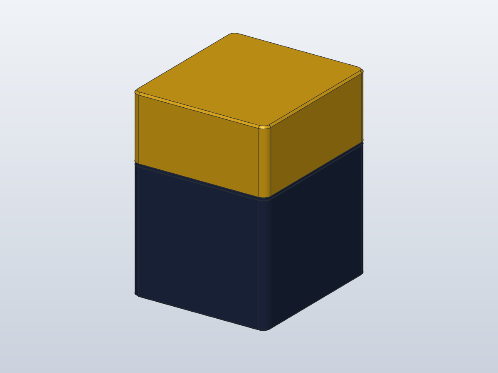
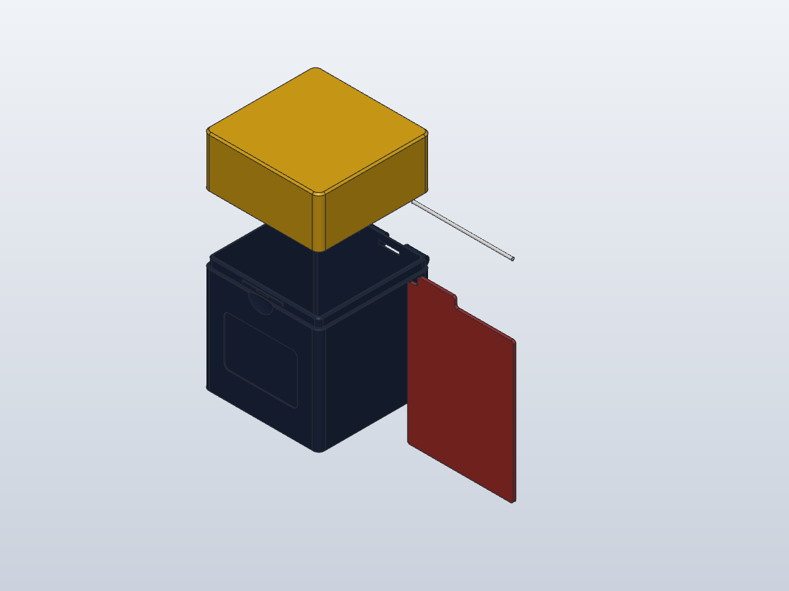

# Deck box YGO — impressão 3D em ABS

Deck box para **90 cartas com sleeve duplo** (tamanho japonês, 62 × 89 mm): main + extra + side deck.
Tampa basculante com dobradiça de 5 nós e pino de filamento, trava de clique escondida, divisória removível.
Imprime **sem suporte**. Modelada em [SolidCraft](https://github.com/bherbruck/solidcraft), 100 % paramétrica.



| Aberta (90 cartas + divisória) | Explodida | Dobradiça |
|---|---|---|
|  |  |  |


## Medidas

| | mm |
|---|---|
| Externa (fechada) | 69,6 × 67,6 × 94,5 |
| Interna | 64 × 62 × 90,5 |
| Paredes / fundo / topo | 2,8 / 2,0 / 2,0 |
| Divisão corpo/tampa | 64 (as cartas ficam ~22 mm acima do lábio para pegar) |

## Peças

| Arquivo | Orientação de impressão | Volume |
|---|---|---|
| `stl/deckbox_corpo.stl` | em pé, fundo na mesa | 55,4 cm³ |
| `stl/deckbox_tampa.stl` | de cabeça para baixo, topo na mesa | 28,1 cm³ |
| `stl/deckbox_divisoria.stl` | deitada | 8,7 cm³ |
| Pino | 59,6 mm de filamento 1,75 | — |

Fonte em `cad/`: `deckbox_ygo.sc` (SolidCraft), `deckbox_ygo.step` (montagem, para qualquer CAD) e `deckbox_build.json` (script que reconstrói o modelo do zero).

Prefere dobradiça de metal? Veja a [variante com dobradiça colada](#variante-dobradiça-de-metal-colada).

## Mecanismos

- **Dobradiça:** 5 nós intercalados (corpo, tampa, corpo, tampa, corpo) com reforços a 45° e furos em gota, então imprime sem suporte. A tampa abre livre até ~168° e para nos reforços.
- **Trava de clique:** um ressalto de 0,6 mm no lábio frontal encaixa numa ranhura escondida na saia da tampa. A interferência fica em 0,3 mm só nos primeiros 2° de abertura.
- **Lábio e saia:** o lábio de 5 mm do corpo entra na saia da tampa com folga de 0,3 mm. Tem chanfro de entrada e um vinco de 0,4 mm na linha de divisão.
- **Cavado do polegar** na frente, logo abaixo da tampa, para abrir com uma mão.
- **Rebaixo de 44 × 30 × 0,6 mm** na frente, para adesivo com o nome do deck.
- **Chanfros** nas bordas que tocam a mesa (0,8 no corpo, 1,0 na tampa), contra o "pé de elefante".

## Impressão em ABS

- Câmara fechada, sem corrente de ar. Mesa 100–110 °C, bico 240–250 °C, ventoinha 0–20 % (30–40 % nas pontes).
- Camada 0,2 mm, **6 perímetros**, 5 camadas de topo e de fundo, 15 % gyroid.
- **Brim de 5–8 mm** no corpo e na tampa.
- Sem suporte. Costura posicionada atrás.
- O topo da tampa e o fundo do corpo ficam com a textura da mesa (PEI texturizado ou vidro).
- Consumo: ~90 g de ABS.

## Montagem

1. Corte 59,6 mm de filamento 1,75 (ABS de preferência).
2. Encaixe a tampa e passe o pino por um lado através dos 5 nós.
3. Os nós das pontas são do corpo: uma gota de acetona ali solda o pino no corpo, e a tampa continua girando livre.

## Calibração

Os parâmetros de ajuste estão marcados como favoritos no SolidCraft:

| Parâmetro | Padrão | Faixa | Efeito |
|---|---|---|---|
| `fit` | 0,3 | 0,2–0,4 | folga da tampa no lábio |
| `ridge_proud` | 0,6 | 0,4–0,8 | força do clique (`ridge_proud - fit`) |
| `hole_body` | 1,9 | 1,8–2,0 | pino justo nos nós do corpo |
| `hole_lid` | 2,2 | 2,1–2,4 | tampa girando solta |
| `hclr` / `hgap` | 0,35 / 0,4 | 0,3–0,5 | folgas radial e axial da dobradiça |

Para mudar outros tamanhos (outro tamanho de sleeve, mais cartas), edite `in_x`, `in_y` ou `in_z`.

Edite no app (Parâmetros) ou reconstrua pela linha de comando:

```bash
solidcraft-cli run cad/deckbox_build.json --save cad/deckbox_ygo.sc
```

Depois exporte cada peça em STL pelo app. O modelo está na posição de montagem, então vire a tampa de cabeça para baixo no fatiador.

## Variante: dobradiça de metal colada

Esta variante troca a dobradiça impressa por uma **dobradiça pequena de 2" (50 × 38 mm, chapa de 1,2 mm)**, dessas vendidas em kit para portinha de armário. Ela é colada com cianoacrilato.

| Rebaixo-guia | Com a dobradiça |
|---|---|
|  |  |

A traseira ganha um **ressalto de 3 mm** com:
- um **rebaixo de 1,2 mm** no tamanho exato da dobradiça, com 0,4 mm de folga, que serve de guia para ela não ficar torta;
- um **canal para o canudo do pino**;
- **base a 45°**, para imprimir sem suporte.

O eixo fica na face do ressalto, então a tampa abre até 180°. A trava de clique continua igual.

| Arquivo | Orientação |
|---|---|
| `stl/deckbox_corpo_dobradica.stl` | em pé |
| `stl/deckbox_tampa_dobradica.stl` | de cabeça para baixo |
| `stl/deckbox_divisoria.stl` | igual à versão normal |

Fonte: `cad/deckbox_ygo_dobradica.sc`, `cad/deckbox_ygo_dobradica.step` e `cad/deckbox_build_dobradica.json`. A profundidade passa para 70,6 mm por causa do ressalto.

**Meça a sua dobradiça antes de imprimir.** O anúncio não informa tudo, e cada lote varia. Ajuste estes parâmetros no SolidCraft:

| Parâmetro | Padrão | O que medir |
|---|---|---|
| `hinge_l` | 50 | comprimento ao longo do pino |
| `hinge_w` | 38 | largura total aberta (as duas abas + o canudo) |
| `hinge_t` | 1,2 | espessura da aba (é a profundidade do rebaixo) |
| `barrel_d` | 5 | diâmetro externo do canudo |
| `pocket_clr` | 0,4 | folga em volta (0,3–0,6) |

**Colagem:**
1. Teste antes sem cola. O lado em que o canudo fica **mais saltado vai para fora**: assim a dobradiça dobra para trás e a tampa abre. Ao contrário, ela não assenta no canal.
2. Lixe as abas e o fundo do rebaixo (lixa 220) e limpe com álcool isopropílico.
3. **Cole com a caixa fechada e travada no clique**, assim a tampa já fica alinhada.
4. Borrife o ativador nas costas das abas e espere secar uns segundos. Pingue poucas gotas de cola no fundo do rebaixo, **longe do canal**: cola no canudo trava a dobradiça. Encaixe e pressione por 30 s.
5. Use pouca cola: o vapor do cianoacrilato deixa o ABS esbranquiçado ("blooming").
6. Se um dia descolar, epóxi bicomponente aguenta melhor impacto do que cianoacrilato.

Verificado da mesma forma que a versão normal: a dobradiça de referência assenta sem interferência; corpo, tampa e cartas não se tocam; a tampa gira livre de 3° a 180°, com o clique em 1–2°.

## Verificação

Feita com booleanas exatas do SolidCraft (`inspect.interference`):

- Caixa fechada, corpo × tampa: 0 de interferência.
- 90 cartas (62 × 55,8 × 89) + divisória em pé + pino de 1,75: 0 de interferência.
- Giro da tampa, de 1° a 180°: só o ressalto da trava encosta a 1–2° (o clique). De 3° a 168° fica livre, e o batente fica em ~169°.
