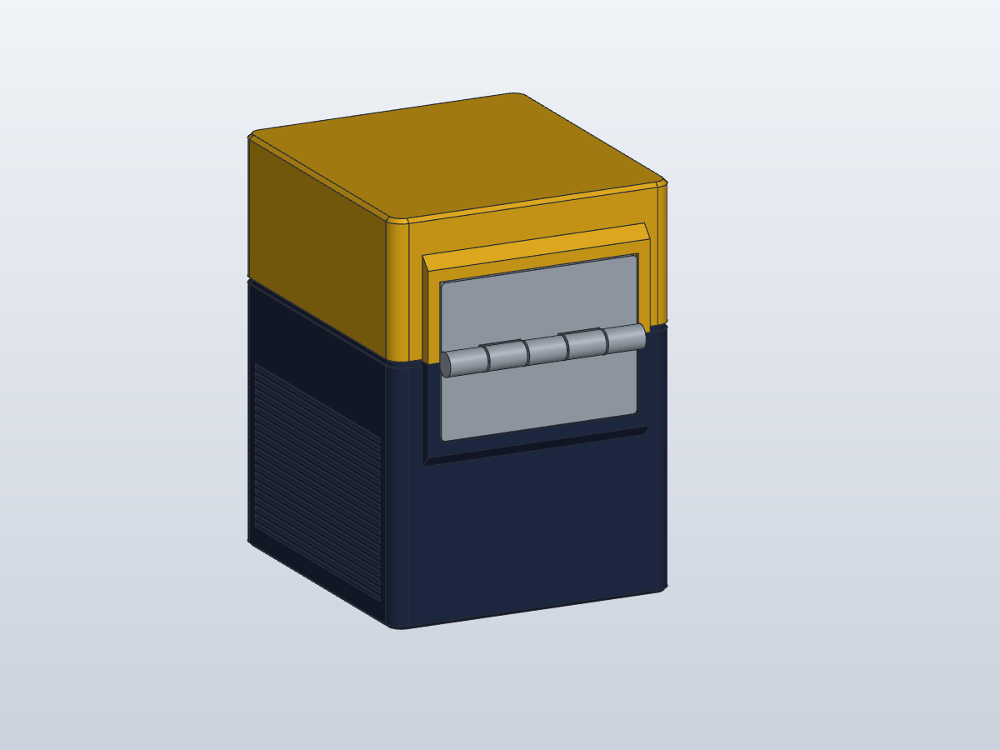
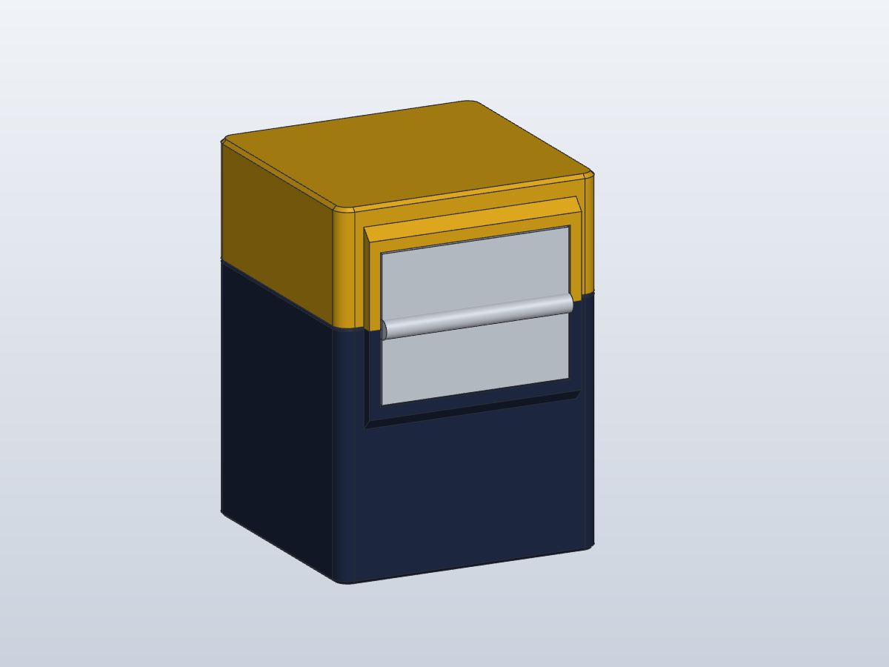

# Deck box YGO — impressão 3D em ABS

Deck box para **90 cartas com sleeve duplo** (tamanho japonês, 62 × 89 mm): main + extra + side deck.
Tem tampa basculante, trava de clique escondida e divisória removível, e imprime **sem suporte**.
Modelada em [SolidCraft](https://github.com/bherbruck/solidcraft), 100 % paramétrica.


## Qual versão imprimir

A caixa é a mesma nas duas versões; muda só a dobradiça.

| | **A — dobradiça integrada** | **B — dobradiça colada** |
|---|---|---|
| Visual |  |  |
| Dobradiça | 5 nós impressos na própria caixa | dobradiça de 50 × 38 mm colada num rebaixo-guia: **de metal** (2") ou a **impressa print-in-place** deste repositório |
| Pino | 59,6 mm de filamento 1,75 (ou aço de 2 mm) | já vem na dobradiça |
| Abertura | até ~168° | até 180° |
| Pasta | [`stl/A-dobradica-integrada`](stl/A-dobradica-integrada) | [`stl/B-dobradica-colada`](stl/B-dobradica-colada) |

Cada pasta tem tudo que precisa ser impresso para aquela versão.

---

## Versão A — dobradiça integrada


### Imprimir

| Arquivo | Orientação | Volume |
|---|---|---|
| `A_corpo.stl` | em pé, fundo na mesa | 55,4 cm³ |
| `A_tampa.stl` | de cabeça para baixo, topo na mesa | 28,1 cm³ |
| `A_divisoria.stl` | deitada | 8,7 cm³ |

Os arquivos já estão na posição de impressão. Total: ~90 g de ABS.

### Montar

1. Corte **59,6 mm de filamento 1,75** (ABS de preferência).
2. Encaixe a tampa e passe o pino por um lado através dos 5 nós.
3. Os nós das pontas são do corpo: uma gota de acetona ali solda o pino no corpo, e a tampa continua girando livre.

**Pino de aço (opcional, mais durável):** use um raio de bicicleta inox 14G (2,0 mm), corda de piano ou eixo retificado de 2 mm.
- No SolidCraft, mude `hole_body` para **2,0** e `hole_lid` para **2,35**, e gere de novo o corpo e a tampa.
- Prenda as pontas com super bonder (acetona não cola metal).

### Calibrar

| Parâmetro | Padrão | Faixa | Efeito |
|---|---|---|---|
| `fit` | 0,3 | 0,2–0,4 | folga da tampa no lábio |
| `ridge_proud` | 0,6 | 0,4–0,8 | força do clique |
| `hole_body` | 1,9 | 1,8–2,0 | pino justo nos nós do corpo |
| `hole_lid` | 2,2 | 2,1–2,4 | tampa girando solta |
| `hclr` / `hgap` | 0,35 / 0,4 | 0,3–0,5 | folgas radial e axial da dobradiça |

---

## Versão B — dobradiça colada

| Rebaixo-guia | Com dobradiça de metal | Dobradiça impressa |
|---|---|---|
|  |  |  |

A traseira tem um **ressalto de 3 mm** com:
- um **rebaixo de 1,2 mm no tamanho exato da dobradiça**, com 0,4 mm de folga, que serve de guia para ela não ficar torta;
- um **canal para o canudo** do pino;
- **base a 45°**, para imprimir sem suporte.

### Imprimir

| Arquivo | Orientação | Volume |
|---|---|---|
| `B_corpo.stl` | em pé, fundo na mesa | 57,7 cm³ |
| `B_tampa.stl` | de cabeça para baixo, topo na mesa | 30,5 cm³ |
| `B_divisoria.stl` | deitada | 8,7 cm³ |
| `B_dobradica-impressa.stl` | deitada, lado liso na mesa (**só se não for usar a de metal**) | 3,3 cm³ |

Total: ~95 g de ABS.

### Dobradiça de metal

Use uma dobradiça pequena de 2" (50 × 38 mm, chapa de 1,2 mm), dessas vendidas em kit para portinha de armário.

**Meça a sua antes de imprimir a caixa.** Se as medidas não baterem, ajuste estes parâmetros no SolidCraft e gere de novo:

| Parâmetro | Padrão | O que medir |
|---|---|---|
| `hinge_l` | 50 | comprimento ao longo do pino |
| `hinge_w` | 38 | largura total aberta (as duas abas + o canudo) |
| `hinge_t` | 1,2 | espessura da aba (é a profundidade do rebaixo) |
| `barrel_d` | 5 | diâmetro externo do canudo |
| `pocket_clr` | 0,4 | folga em volta (0,3–0,6) |

### Dobradiça impressa (print-in-place)

Ela sai da impressora já montada: 5 nós intercalados, com o pino de 2,6 mm preso dentro dos nós.
- As folgas são de 0,4 mm entre pino e furo e de 0,5 mm entre os nós.
- Os nós que giram têm furo em gota, então o teto do furo sai a 45° e não gruda no pino.

1. **Imprima primeiro só ela** (~3,5 g): as folgas dependem da sua impressora.
2. Deitada, como está no arquivo, sem suporte. Não esmague demais a primeira camada, senão o "pé de elefante" solda os nós.
3. Ao tirar da mesa, **dobre devagar para um lado e para o outro** algumas vezes, até girar livre.
4. Se sair grudada, aumente `pip_clr` (0,45–0,5) e `pip_gap` (0,6) no SolidCraft e gere de novo.

### Colar (metal ou impressa)

1. **Teste antes sem cola.**
   - Metal: o lado em que o canudo fica mais saltado vai para fora.
   - Impressa: o lado liso (o que ficou na mesa) vai para dentro do rebaixo.
2. Lixe as abas e o fundo do rebaixo (lixa 220) e limpe com álcool isopropílico.
3. **Cole com a caixa fechada e travada no clique**, assim a tampa já fica alinhada.
4. Borrife o **ativador de cianoacrilato** nas costas das abas e espere secar uns segundos. Pingue poucas gotas de super bonder no rebaixo, **longe do canal**: cola no canudo trava a dobradiça. Encaixe e pressione por 30 s.
5. Use pouca cola: o vapor do cianoacrilato deixa o ABS esbranquiçado ("blooming").
6. Se um dia descolar, epóxi bicomponente aguenta melhor impacto.

---

## Configuração de impressão (ABS, vale para tudo)

| | |
|---|---|
| Câmara | fechada, sem corrente de ar |
| Temperatura | mesa 100–110 °C, bico 240–250 °C |
| Ventoinha | 0–20 % (30–40 % nas pontes) |
| Camada | 0,2 mm |
| Perímetros | **6** (as paredes ficam maciças) |
| Topo e fundo | 5 camadas |
| Preenchimento | 15 % gyroid |
| Brim | **5–8 mm** no corpo e na tampa; a divisória e a dobradiça não precisam |
| Suporte | nenhum |
| Costura | atrás |

O topo da tampa e o fundo do corpo ficam com a textura da mesa (PEI texturizado ou vidro).

---

## Medidas e mecanismos

| | mm |
|---|---|
| Externa (fechada) | 69,6 × 67,6 × 94,5 (B: 70,6 de profundidade, por causa do ressalto) |
| Interna | 64 × 62 × 90,5 |
| Paredes / fundo / topo | 2,8 / 2,0 / 2,0 |
| Divisão corpo/tampa | 64 (as cartas ficam ~22 mm acima do lábio para pegar) |

- **Trava de clique:** um ressalto de 0,6 mm no lábio frontal encaixa numa ranhura escondida na tampa. A interferência é de 0,3 mm, só nos primeiros 1–2° de abertura.
- **Lábio e saia:** o lábio de 5 mm do corpo entra na saia da tampa com 0,3 mm de folga. Tem chanfro de entrada e um vinco de 0,4 mm na linha de divisão.
- **Dobradiça integrada (A):** 5 nós com reforços a 45° e furos em gota, então imprime sem suporte.
- **Cavado do polegar** na frente, para abrir com uma mão.
- **Rebaixo de 44 × 30 × 0,6 mm** na frente, para um adesivo com o nome do deck.
- **Chanfros** nas bordas que tocam a mesa (0,8 no corpo, 1,0 na tampa), contra o pé de elefante.

| Detalhe da frente | Explodida (A) |
|---|---|
|  |  |

## Verificação

Feita com booleanas exatas do SolidCraft (`inspect.interference`):

| | A | B |
|---|---|---|
| Caixa fechada (corpo × tampa) | 0 de interferência | 0 de interferência |
| 90 cartas (62 × 55,8 × 89) + divisória | 0 | 0 |
| Pino / dobradiça montada | pino de 1,75 sem tocar | dobradiça de metal e impressa sem tocar |
| Giro da tampa | clique a 1–2°, livre de 3° a 168°, batente a ~169° | clique a 1–2°, livre até 180° |
| Dobradiça impressa sozinha | — | plana sem as abas se tocarem, dobra livre até 180° |

## Editar o modelo

Os arquivos editáveis estão em `cad/A-dobradica-integrada/` e `cad/B-dobradica-colada/`:
- `.sc` — projeto do SolidCraft, com os parâmetros de calibração marcados como favoritos;
- `.step` — para abrir em qualquer CAD;
- `_build.json` — script que reconstrói o modelo do zero.

Para mudar o tamanho (outro sleeve, mais cartas), edite `in_x`, `in_y` ou `in_z`.

Edite no app, em Parâmetros, ou reconstrua pela linha de comando:

```bash
solidcraft-cli run cad/A-dobradica-integrada/A_deckbox_build.json --save cad/A-dobradica-integrada/A_deckbox.sc
```

Depois exporte cada peça em STL pelo app. O modelo fica na posição de montagem, então vire a tampa de cabeça para baixo no fatiador.
