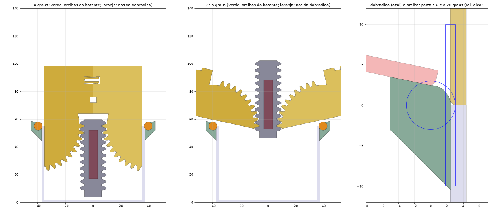

# Caixa D "asas" — em andamento

Caixa nova inspirada no vídeo da "Caixa de Deck Mecânica EDH" (Cults): duas portas abrem como asas e o berço
sobe por engrenagem e cremalheira. Projeto do zero, para Yu-Gi-Oh (90 cartas com sleeve duplo, mesmo berço da C).
Regras de folga e de impressão do projeto inteiro: [`GUIA_IMPRESSAO_3D.md`](../../GUIA_IMPRESSAO_3D.md).



## Como gerar

```
pip install shapely pillow
python cad/D-asas/geo_d.py        # só as checagens 2D (rápido)
python cad/D-asas/gerar_d.py      # escreve D_asas_build.json e D_verificacao.json
solidcraft-cli run cad/D-asas/D_asas_build.json --save cad/D-asas/D_asas.sc --quiet   # ~2 min
python cad/D-asas/verificar_d.py  # 35 checagens no solidcraft-cli, diz ok/FALHA (~10 min)
python cad/D-asas/exportar_stl_d.py   # STLs na posição de impressão em stl/D-asas/ (~1 min)
python cad/D-asas/render_d.py         # imagens do README em images/D_*.png (~3 min)
python cad/D-asas/animar_d.py --export  # GIFs de montagem e funcionamento (Blender 5.2+)
```

- **Programas:** os scripts acham o `solidcraft-cli` e o Blender sozinhos nos dois computadores do projeto. Em outro lugar, use as variáveis `SOLIDCRAFT_CLI` e `BLENDER`.
- **O `.sc` não vai para o git** enquanto o projeto muda (23 MB): ele sai do build JSON com o comando acima.
- **`D_verificacao.json`** é uma lista de chamadas `batch` do MCP do SolidCraft. `verificar_d.py` roda as mesmas sem o MCP (`--reuse` só reanalisa a última saída).

## Decisões (e por quê)

- **Medidas:** 74,2 × 85,6 × 100,1 mm (+5,4 mm da dobradiça de cada lado). A divisão base/portas fica em z = 55.
- **Eixos das portas:** paralelos a Y, a 2,4 mm por fora das laterais. Um eixo por dentro faria a borda da porta varrer o berço.
- **Engrenagem:** m 1,5, z 42 (R 31,5), α 20°, folga de 0,1 por flanco em cada peça (0,4 no total, a faixa das referências de FDM).
  - Cada porta leva 2 placas-setor (frente e trás), com 10 dentes evolventes.
  - As placas engrenam em 2 cremalheiras duplas (frente e trás).
- **Engrenadas desde 0°:** as portas abrem juntas. Uma espera com a cremalheira parada não funciona: com cremalheira reta, os dentes do setor varrem a faixa dos dentes dela parada e batem.
- **Espera de 12° por folga morta:** a cremalheira corre 6,6 mm numa cauda de andorinha do berço antes de pegar nele. As cartas não batem no teto da porta: folga mínima de 2,5 mm em todo o giro (com 10° seria 1,9 mm a 26°).
- **Duas cremalheiras (frente e trás):** com uma só atrás, o berço trava. O peso fica a ~38 mm do ponto de apoio, e a guia que sobra com o berço em cima (~18 mm) é menor que 72·μ ≈ 25 mm.
- **Subida:** curso da cremalheira 42,9 mm e berço +36,3 mm a 78°.
- **Dobradiça (2026-11-26):** peça impressa já montada (print-in-place), **colada**. É a receita da dobradiça da B, que já funcionou na impressora:
  - abas de 1,2 com o eixo 3,0 acima da face colada (os nós encostam na mesa); 7 nós, pino de 2,6 preso nos 4 nós da aba da base, furo em gota nos 3 da porta;
  - folgas: pino 0,35, entre nós 0,4, nó contra a aba do outro lado 0,4. A B saiu perfeita com 0,4/0,5 (um pouco solta) e tem 0,3/0,35 como versão mais justa;
  - **rebaixos de 0,6 na base e na porta**, com 0,15 de folga em volta, posicionam a aba. Por isso o eixo fica a 3,0 − 0,6 = 2,4 da lateral. Com a dobradiça colada, a posição do eixo vem dos rebaixos, e a distância até a cremalheira é a que importa para a engrenagem;
  - um canal de r 3,4 na emenda deixa os nós girarem sem raspar na base nem na porta;
  - não tem mais pino de filamento.
- **Batente nas orelhas (2026-11-26):** 4 orelhas na base, nas pontas das dobradiças, com 45° por baixo. O topo de cada uma é o lugar da lateral da porta girada até 78°, então a porta encosta ali a 78° e o esforço vai direto para a base.
  - Antes, o batente era a barra de baixo da dobradiça integrada.
  - Numa dobradiça impressa deitada, o batente teria de ser um "capuz" por cima dos nós, que não imprime.
- **Segurar aberta:** um arco concêntrico (tipo Genebra) não sustenta a cremalheira — com o contato abaixo do nível do eixo, ela só cai. Por isso:
  - uma lingueta na parede de trás da base (cortes a 45° de 0,9, imprime sem suporte e não solda) tem um ressalto de 0,5;
  - a cremalheira de trás tem uma nervura de 0,6 (flanco de baixo a 45°, de cima a 30°) que passa por cima do ressalto perto de 75° (clique);
  - a lingueta segura ~6 N contra os ~2,9 N do baralho;
  - aberta, o centro de gravidade das portas fica por fora e elas descansam no batente.
- **Fechamento:**
  - **Engate:** na emenda das placas da esquerda há 2 hastes com farpas (snap), que entram no receptáculo das placas da direita.
    - As hastes afinam de 1,4 para 1,0, têm farpa de 0,6 e entram com 0,25 de folga.
    - A haste cede 0,28 (deformação de 0,5 %).
    - Vão de 0,6 em volta da haste dentro da própria placa (menos que ~0,5 solda) e fundo em meia-lua na raiz.
  - **Ímãs:** 1 ímã 4×2 por placa (z = 74), num rasgo de 4,3 × 2,15 aberto na espessura toda. Fechado, a pele por cima do furo teria só 0,4 mm.
  - **Placas E e D são diferentes:** 2 STLs, 2 de cada. Confira a polaridade dos ímãs antes de colar.
- **Placas:** encostam no teto e na lateral da porta e ficam presas por 2 pinos impressos colados (super bonder) cada, pela parede da porta.
  - **Pino:** haste Ø2,5 × 5,5 e cabeça Ø4,8 × 0,8 (`PIN` em `gerar_d.py`).
  - **Furos de Ø2,8:** 0,15 por lado para a cola. Na porta o furo é horizontal na impressão, por isso em gota.
- **Pé de elefante:** as placas (nas duas faces) e as cremalheiras (na face do rasgo) têm a borda 0,2 mm para dentro nos primeiros 0,3 mm. O rasgo da cauda de andorinha tem boca chanfrada de 0,4.
- **Cauda de andorinha:** 0,25 de folga nos flancos e 0,3 no fundo (o teto do rasgo é ponte e cede um pouco).
- **Acabamento:**
  - painel rebaixado na frente da base (adesivo) e friso de 1,0 no teto das portas;
  - entalhe para a unha na emenda;
  - pés de silicone e texto no fundo.

## Estado (2026-11-26)

- **Revisão para imprimir de primeira:**
  - dobradiça print-in-place colada e batente nas orelhas (acima);
  - folgas do [guia](../../GUIA_IMPRESSAO_3D.md);
  - alívio de pé de elefante;
  - ímã em rasgo aberto;
  - furos em gota;
  - engate com folga de 0,25;
  - cortes da lingueta mais largos.
- **Peças de teste** (`D_teste_deitado.stl` e `D_teste_em_pe.stl`, ~10 g): engrenagem montada (base com trilho e eixo, setor, cremalheira), emenda (engate, ímã, furo do pino), mini dobradiça de 3 nós, pino, pedaço de parede da porta com o furo em gota, lingueta da trava e trilho do berço.
- **Checagens 2D OK:**
  - dentes sem sobreposição de 0° a 78°, folga mínima de 0,19;
  - nenhuma parte da placa fora da porta;
  - cartas com 2,5 de folga;
  - batente livre a 77,5° e encostando a 78,5°.
- **Verificação 3D:** 35 checagens, 34 ok + 1 informativa (o sentido de abertura).
  - Ao sair da dobradiça integrada, a ponta da fatia do setor (no eixo) ficou 4 mm fora da porta. Agora a placa é cortada na lateral da porta também acima da divisão.
  - O 2D ganhou essa checagem.
- **Arquivos gerados:**
  - STLs: 13 arquivos em `stl/D-asas/`, incluindo `D_dobradica_x2` (as duas abas juntas, deitada) e as peças de teste;
  - renders novos: `D_dobradica` e `D_batente`;
  - GIFs refeitos com a ordem de montagem nova (dobradiças com fita crepe, teste, cola).
- **Ordem de montagem:**
  1. cremalheiras no berço por baixo;
  2. placas deslizando de lado sobre as cremalheiras, já engatadas na emenda;
  3. conjunto na base;
  4. portas por cima, fechadas;
  5. pinos das placas, secos;
  6. dobradiças nos rebaixos, presas com fita crepe;
  7. teste;
  8. cola nas dobradiças (caixa fechada), depois nos pinos das placas.

  Não dá para encaixar a cremalheira com as portas abertas: ela bate nos dentes 7 e 8 do setor, e o batente fica em 78°.
- **Pendente:**
  - imprimir as peças de teste e ajustar o que precisar (`bl`, `dt_clr`, `SNAP`, `hk_*`, `SLIT`);
  - depois, placas + cremalheiras + base para testar o mecanismo de verdade;
  - quando fechar o projeto: o `.sc` e um `.step` no git, como nas outras versões.
